# ha-uptime-card

[](https://www.home-assistant.io/integrations/marketplace/)
[](https://github.com/juju35/ha-uptime-card/actions/workflows/hacs.yml)
[](https://github.com/juju35/ha-uptime-card/actions/workflows/validate.yml)
[](https://github.com/juju35/ha-uptime-card/actions/workflows/lint.yml)
[](https://github.com/juju35/ha-uptime-card/releases/latest)
[](https://github.com/juju35/ha-uptime-card/blob/main/LICENSE)
[](https://buymeacoffee.com/julienstep9)

Lovelace cards for Home Assistant to watch your services at a glance: which ones are **up, down, pending or in maintenance**, their **response time**, a **24-hour uptime bar** from the history, the **expiry of their SSL certificates** with an alert before it is too late, all **grouped by tag**.

The cards work on top of the integrations you already use — [Uptime Kuma](https://www.home-assistant.io/integrations/uptime_kuma/), [Healthchecks.io](https://github.com/custom-components/healthchecksio), [Ping](https://www.home-assistant.io/integrations/ping/), any **connectivity** binary sensor and [Certificate Expiry](https://www.home-assistant.io/integrations/cert_expiry/). Services are **discovered automatically** from the Home Assistant registries: you don't pick the entities one by one, and it works whatever your Home Assistant language or entity ids. A drawn server rack sums up the state of everything, and animates with it.

[](https://my.home-assistant.io/redirect/marketplace_repository/?owner=juju35&repository=ha-uptime-card&category=plugin)

| Uptime Card | Uptime Mini Card |
|---|---|
|  | 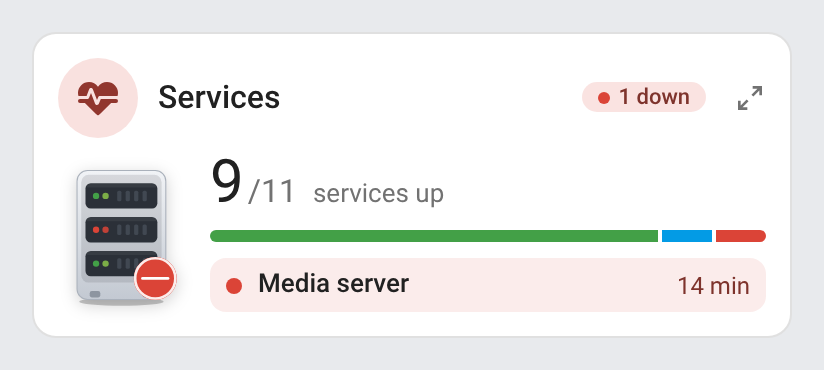<br><br>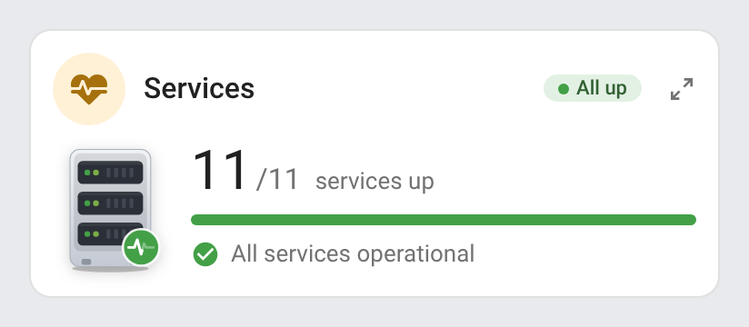 |

## Features

- Two cards: a full **Uptime Card** (`custom:uptime-card`) and a compact **Uptime Mini Card** (`custom:uptime-mini-card`)
- Services found on their own: every Uptime Kuma monitor, Ping host, Healthchecks.io check and Certificate Expiry certificate; or the entities you list (any connectivity or problem binary sensor, any sensor reading up / down / online / offline…)
- Status of each service (**up**, **down**, **pending**, **maintenance**), with how long it has been down
- **Response time** (Uptime Kuma, Ping), in orange above a threshold you choose
- **Uptime bar** of the last 24 hours (48 slices of 30 minutes, each in the color of the worst status seen in it) and the **uptime percentage**, from the Home Assistant history (or Uptime Kuma's own 1-day uptime sensor when it is enabled)
- **SSL certificate expiry** (Uptime Kuma, Certificate Expiry): days left on every row, the date in its tooltip, orange then red as the expiry gets close, red when expired or invalid; a Certificate Expiry certificate goes to the row of the service of the same host
- **Groups by tag** (Uptime Kuma tags and Home Assistant labels), by integration, or none; collapsible groups, a group with a service down always unfolded
- An overview at the top of the full card: a drawn server rack in the color of the worst status, animated by it (see [Animations](#animations)), the status in words, the share of services up, the service down the longest, the most urgent certificate and the integrations the services come from
- Header icon in the color of the worst status (certificates and slow responses included), status chip on the right: `All up`, `1 down`, `1 pending`, `1 in maintenance`
- Mini card: how many services are up out of how many, a bar of the statuses and the services down; its detail button (top right) switches it to the full card's content and back, a click anywhere outside the card brings the compact view back
- Filters: only the services with a problem, some tags, some integrations, excluded entities; sort by status (problems first) or by name
- Click a service to open its Home Assistant history (more-info dialog)
- Sections view: the full card takes 12 columns by default and at least 9, the mini card 6; narrow widths get their own layout (see [Screenshots](#screenshots))
- Visual editor in the dashboard UI for both cards (no YAML needed)
- Light and dark mode, English, French, German, Spanish, Serbian (Cyrillic and Latin), Italian, Dutch, European Portuguese, Polish, Romanian, Danish, Swedish, Bulgarian, Russian, Ukrainian, Hungarian, Slovak, Czech, Slovenian, Latvian and Greek
- Single file, no external dependency; the other languages are loaded on demand

## Supported integrations

| Integration | What the cards show |
|---|---|
|  [Uptime Kuma](https://www.home-assistant.io/integrations/uptime_kuma/) (core, Uptime Kuma 2.0 or later) | One service per monitor: status (up, down, pending, maintenance), response time, certificate days left, URL or hostname, monitor type; **tags** when the monitor's *Tags* sensor is enabled; 1-day uptime when its *Uptime (1 day)* sensor is enabled |
|  [Healthchecks.io](https://github.com/custom-components/healthchecksio) (custom, `healthchecksio`) | One service per check: up or down, time of the last ping |
| [Ping](https://www.home-assistant.io/integrations/ping/) (core) | One service per host: connected or not, round trip time when its *Round trip time average* sensor is enabled |
| [Certificate Expiry](https://www.home-assistant.io/integrations/cert_expiry/) (core) | The expiry of a certificate: on the row of the service of the same host (an Uptime Kuma URL or hostname, a Ping host), else a row of its own (down once expired or invalid) |
| Any binary sensor or sensor (listed in `entities`) | A `connectivity` binary sensor is up when on, a `problem` one is down when on; a sensor reading `up`, `on`, `online`, `ok`, `connected`… is up, `down`, `off`, `offline`, `error`, `problem`… is down |

The Uptime Kuma *Tags*, *Uptime (1 day)* and Ping *Round trip time average* sensors are disabled by default in Home Assistant: enable them on the device page to get the tags, the uptime and the round trip time. Home Assistant **labels** on a service's entity or device group it too, whatever its integration.

## Prerequisites

Home Assistant 2024.8 or later, with at least one of the [supported integrations](#supported-integrations) configured, or entities to list. The uptime bar and percentage read the recorder's history: an entity excluded from the recorder shows no bar.

## Installation

### Via the Marketplace (recommended)

Click the button below to add the repository directly:

[](https://my.home-assistant.io/redirect/marketplace_repository/?owner=juju35&repository=ha-uptime-card&category=plugin)

Then click **Install**, and reload your browser when the Marketplace asks you to.

Or manually:

1. Open **Settings → Marketplace → Add from link** (top right; this needs a GitHub account connected)
2. Add `https://github.com/juju35/ha-uptime-card` — Type: **Dashboard**
3. Open **Uptime Card** and click **Install**
4. Clear your browser cache and refresh

The resource is added as `/local/community/ha-uptime-card/uptime-card.js` (**Settings → Dashboards → ⋮ → Resources**).

### Manual

1. Download `uptime-card.js` and the `uptime-card.i18n.*.js` translation files from the [latest release](https://github.com/juju35/ha-uptime-card/releases/latest)
2. Copy them all to `/config/www/` (without the translation files, the cards show in English)
3. Go to **Settings → Dashboards → ⋮ → Resources** → Add resource:
   - URL: `/local/uptime-card.js`
   - Type: **JavaScript Module**
4. Clear your browser cache and refresh

## Configuration

### Card types

| Card | Type |
|---|---|
| Uptime Card | `custom:uptime-card` |
| Uptime Mini Card | `custom:uptime-mini-card` |

### Visual editor

Edit a dashboard, click **Add card** and search for **Uptime Card** or **Uptime Mini Card**. Every service found is shown right away; pick entities in the list to show only those, choose the grouping, the sort, what each row shows, the thresholds and the language. The preview updates live, and options left at their default are kept out of the generated YAML.

### Minimal

```yaml
type: custom:uptime-card
```

```yaml
type: custom:uptime-mini-card
```

### Full options

```yaml
type: custom:uptime-card
title: Homelab
group_by: tag              # tag, source or none
sort: status               # status (problems first) or name
tags: [Web, Media]         # only these tags, in this order
sources: [uptime_kuma, ping, healthchecks, cert_expiry]
exclude:
  - binary_sensor.printer
collapsed: [Infrastructure] # or true to fold every group
only_problems: false
show_hero: true
show_latency: true
show_history: true
show_uptime: true
show_ssl: true
hours: 24
ssl_warning_days: 14
ssl_critical_days: 3
latency_warning: 1000
language: en
```

Listing the services yourself (an Uptime Kuma status sensor keeps its response time, certificate and tags; any other entity becomes a service of its own):

```yaml
type: custom:uptime-card
entities:
  - sensor.cloud_drive_status
  - entity: binary_sensor.printer
    name: Office printer
    tags: [Office]
  - entity: binary_sensor.website_online
    latency_entity: sensor.website_response_time
    cert_entity: sensor.example_com_cert_expiry
auto: true                 # also add every service found (default: only the listed ones)
```

### Options reference

| Option | Card | Default | Description |
|---|---|---|---|
| `title` | both | `Services` (translated) | Card title |
| `show_title` | both | `true` | Show the title in the header (e.g. `false` under a section heading of your own) |
| `show_subtitle` | both | `true` | Show the subtitle (`9/11 up`) under the title |
| `entities` | both | — | Services to show, in this order: entity ids, or objects with `entity` and optional `name`, `tags` (list), `latency_entity` (milliseconds or seconds), `cert_entity` (a timestamp, or days left) and `uptime_entity` (percent). Without it, every service found is shown |
| `auto` | both | `true` without `entities`, else `false` | Also add every service found to the listed ones |
| `sources` | both | all | Integrations to find services in: `uptime_kuma`, `healthchecks`, `ping`, `cert_expiry` |
| `exclude` | both | — | Entity ids of services found that the card leaves out |
| `tags` | both | — | Only the services with one of these tags (Uptime Kuma tags, Home Assistant labels or `tags` of `entities`); the groups follow this order |
| `group_by` | full | `tag` | `tag` (a service with several tags appears in each group; untagged ones go to *Other*), `source` (by integration) or `none` |
| `sort` | full | `status` | `status` (down, pending, maintenance, unknown, then up; by name within) or `name` |
| `collapsed` | full | — | Groups folded by default, by name (`[Media, Other]`), or `true` for all. Click a group title (or Tab to it and press Enter or Space) to fold or unfold it; a click elsewhere folds it back. A group with a service down is always unfolded |
| `only_problems` | full | `false` | Only list the services that are not up or whose certificate needs attention (the header still counts them all) |
| `show_hero` | full | `true` | The overview at the top: rack picture, status, share of services up, alerts and integrations |
| `show_latency` | full | `true` | Response time of each service |
| `show_history` | full | `true` | Uptime bar of each service |
| `show_uptime` | full | `true` | Uptime percentage of each service (whole percent, rounded down: 99.97 % reads 99 %) |
| `show_ssl` | full | `true` | Certificate expiry of each service, and its alerts |
| `hours` | full | `24` | Length of the history of the uptime bar and percentage, in hours |
| `ssl_warning_days` | both | `14` | Certificate in orange from this many days left |
| `ssl_critical_days` | both | `3` | Certificate in red from this many days left (and once expired or invalid) |
| `latency_warning` | full | `1000` | Response time in orange above this many milliseconds |
| `max_items` | mini | `5` | Services down listed on the mini card (the others are counted as `+N`) |
| `zoom` | mini | `true` | Detail button at the top right of the mini card: it shows the full card's content (with the same options, so `group_by`, `only_problems`… can be set on the mini card too) and switches back to the compact view; a click outside the card also brings the compact view back. `false` removes the button |
| `language` | both | Auto | Force language: `fr`, `en`, `de`, `es`, `sr`, `sr-Latn`, `it`, `nl`, `pt`, `pl`, `ro`, `da`, `sv`, `bg`, `ru`, `uk`, `hu`, `sk`, `cs`, `sl`, `lv` or `el` (auto-detects from HA settings) |

## Screenshots

### Animations

The rack picture animates to match the worst status of your services, and every animation honours `prefers-reduced-motion`. Each state plays its own animation:

Everything up: the heartbeat trace runs across the badge and the drive lights flicker:

| Light | Dark |
|---|---|
| 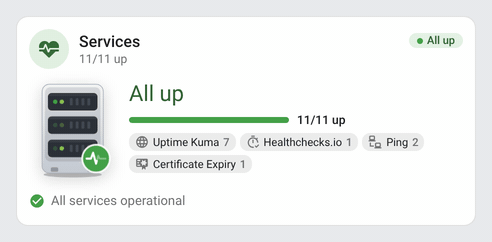 | 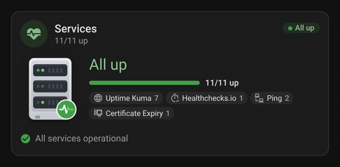 |

A service down: alarm rings spread from the badge, the failed unit blinks red, and the dot of the service's row pulses:

| Light | Dark |
|---|---|
| 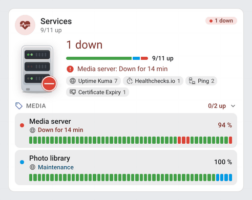 | 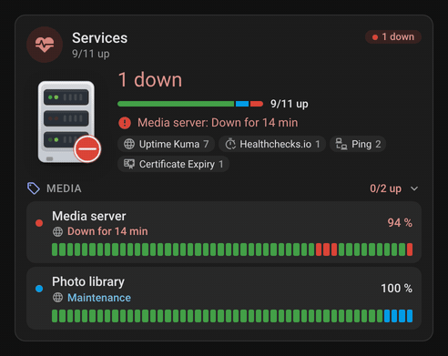 |

A service pending (Uptime Kuma retrying): the dots of the badge light up in turn, the lights and the row's dot blink orange:

| Light | Dark |
|---|---|
| 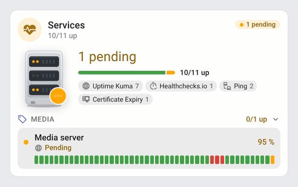 | 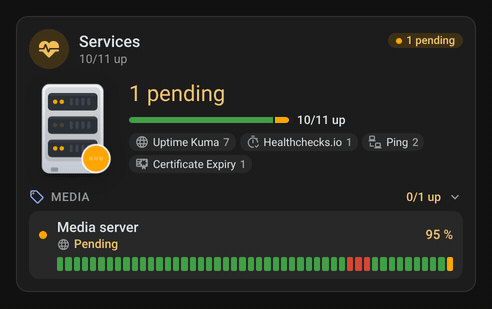 |

A service in maintenance: the wrench of the badge swings:

| Light | Dark |
|---|---|
| 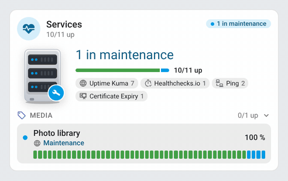 | 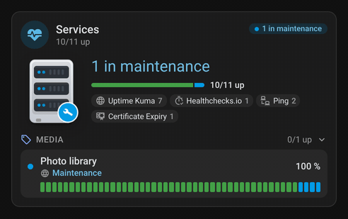 |

### Full card

Grouped by tag (Uptime Kuma tags and Home Assistant labels), problems first in each group. The Router row carries the certificate of its Certificate Expiry entry (same host); the Cloud drive certificate, 9 days from expiry, is in orange:

| Light | Dark |
|---|---|
|  | 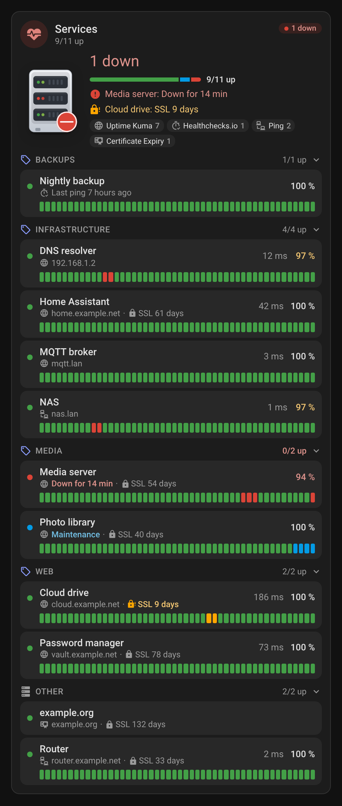 |

Groups folded (`collapsed: true`): the Media group, with a service down, stays unfolded. Only the services with a problem (`only_problems: true`):

| Folded groups | Only problems |
|---|---|
| 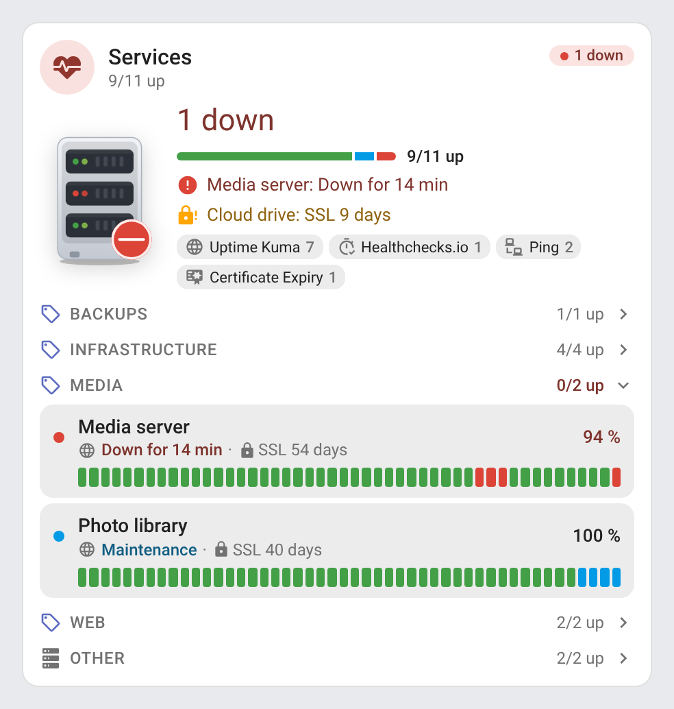 | 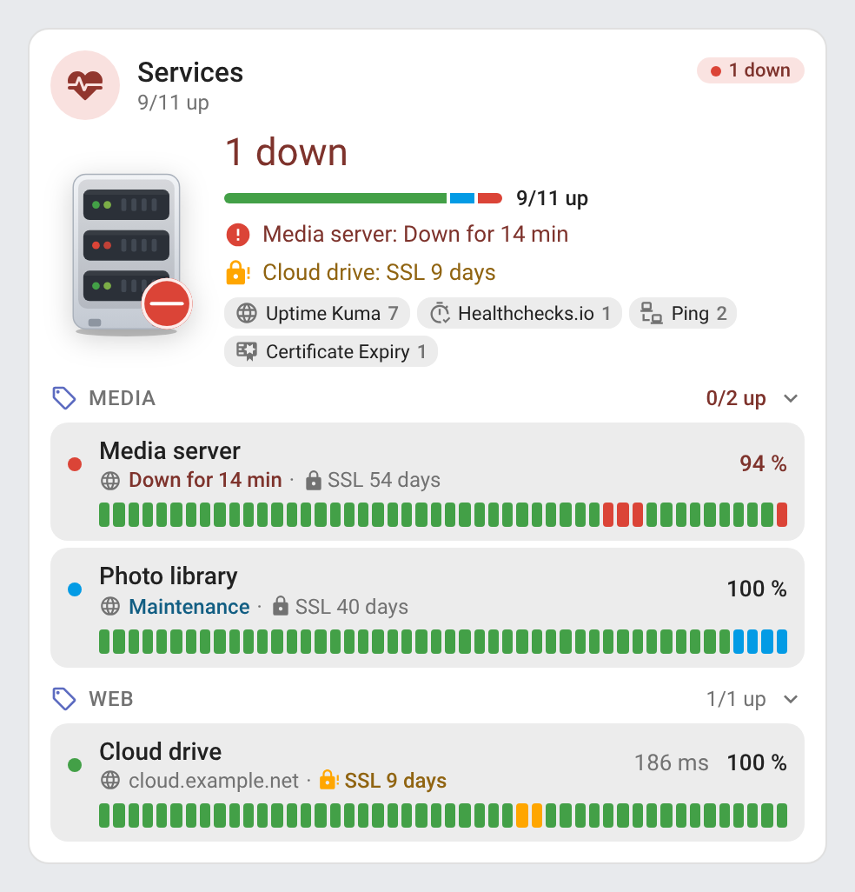 |
| 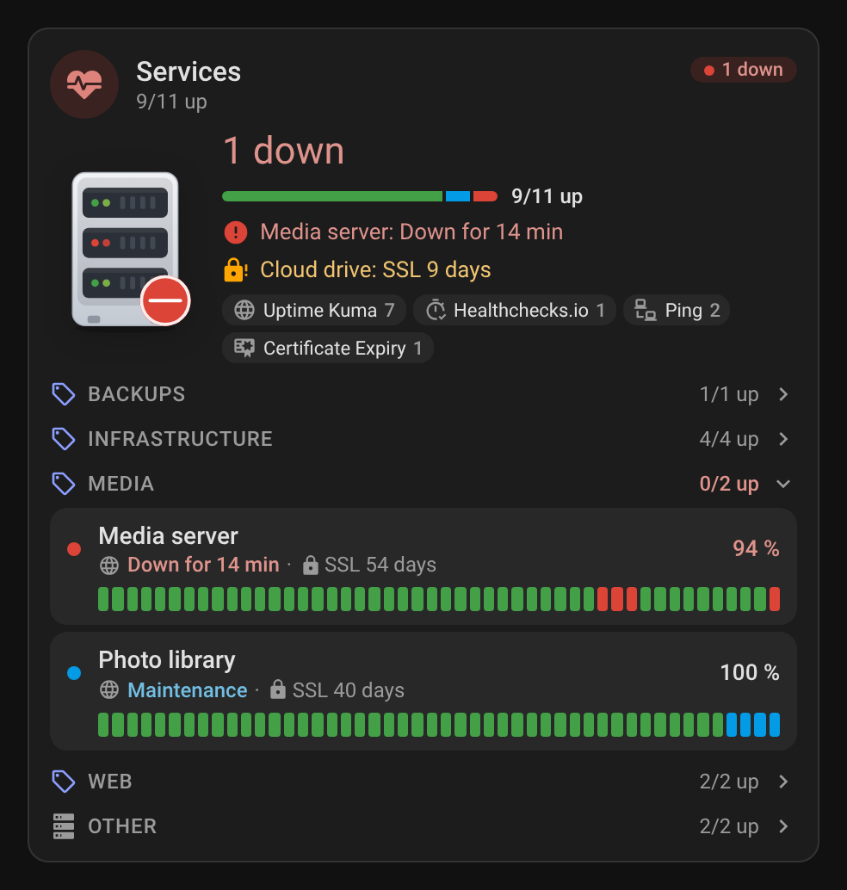 | 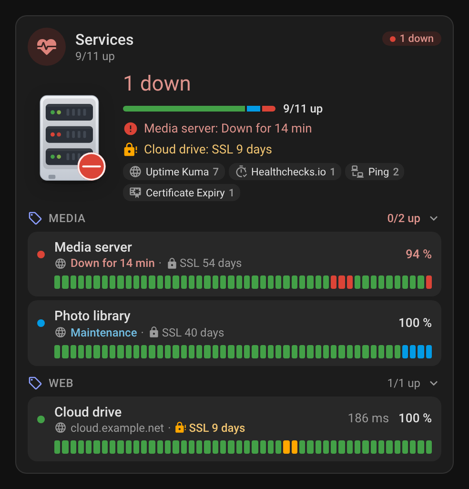 |

Grouped by integration, without the overview (`group_by: source`, `show_hero: false`):

| Light | Dark |
|---|---|
| 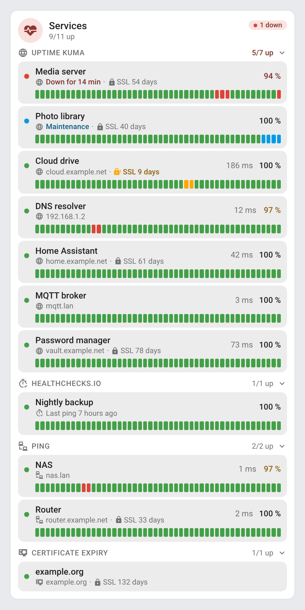 | 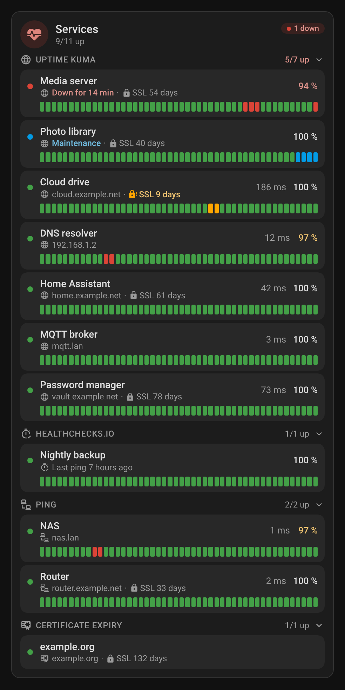 |

### Mini card

How many services are up, the bar of the statuses and the services down with how long they have been down; with everything up, a single line says so:

| Light | Dark |
|---|---|
|  | 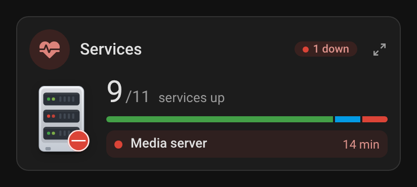 |
|  | 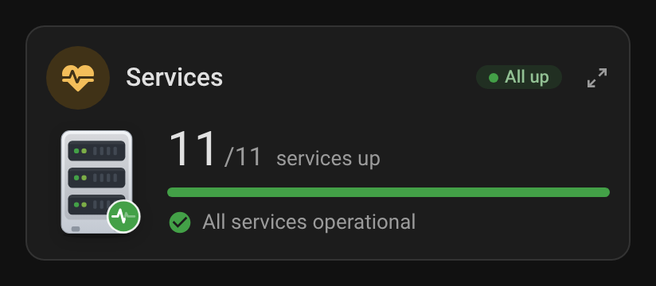 |

The detail button (top right) switches the mini card to the full card's content:

| Light | Dark |
|---|---|
| 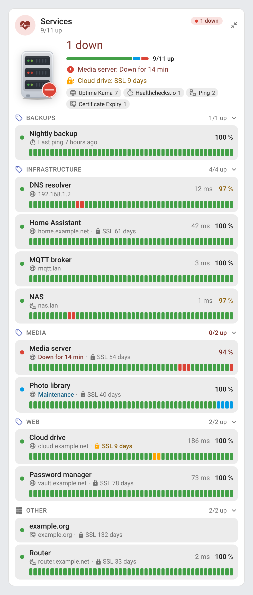 | 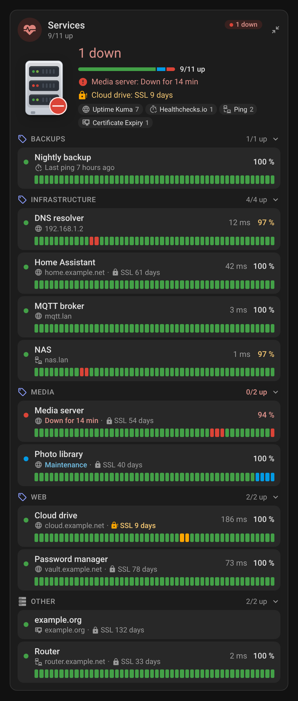 |

### Narrow cards

The full card at its minimum width (9 of 12 columns of a narrow Sections view, 238 px: the picture goes above the overview, the uptime percentage gives way) and the mini card at 6 columns on a phone (170 px: the picture and the durations give way):

| Full card | Mini card |
|---|---|
| 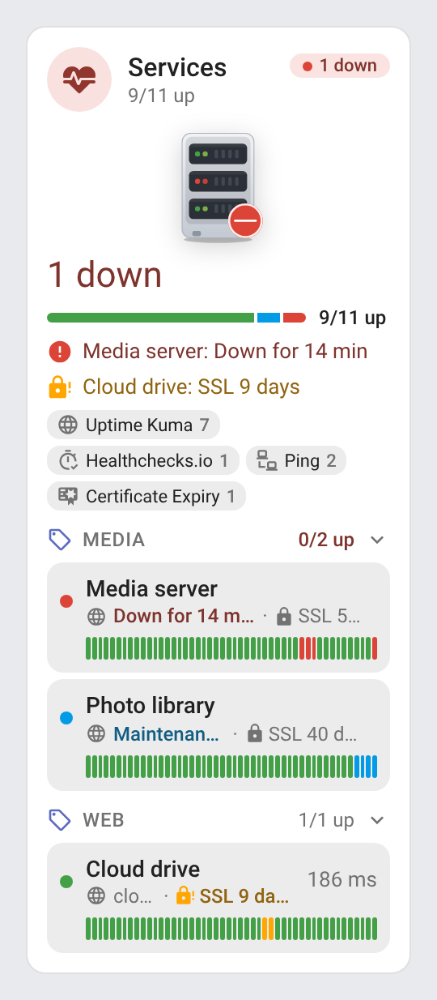 | 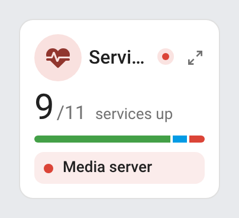 |
| 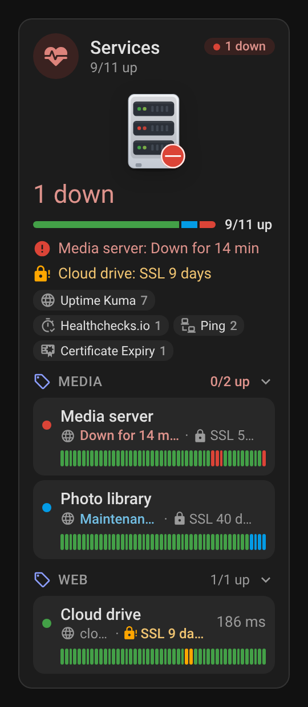 | 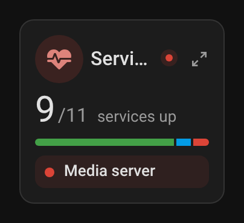 |

## How it works

The cards read the Home Assistant entity and device registries instead of entity ids: an Uptime Kuma monitor is the device of a `status` sensor of the `uptime_kuma` platform, with its `response_time`, `cert_days_remaining`, `url`, `hostname`, `type`, `tags` and `uptime_1d` sensors; a Ping host is a `ping` binary sensor, with the `round_trip_time_avg` sensor of its device; a Healthchecks.io check is a `healthchecksio` binary sensor; a certificate is a `cert_expiry` sensor, whose host comes from its device. Entity ids can therefore be in any language or renamed without breaking the cards. Disabled entities are left out, and so is a service whose status entity is hidden (a hidden URL, response time or certificate sensor still adds to its monitor).

The uptime bar asks the recorder for the history of the status entities (one request for all of them, again every 5 minutes) and splits the window into 48 equal slices, each drawn in the color of the worst status seen in it (grey without data). The uptime percentage is the time up over the time up or down: maintenance, pending and unknown periods are left out.

## Development

```bash
npm install
npm run build        # bundles src/uptime-card.js into dist/uptime-card.js, other languages into dist/uptime-card.i18n.<lang>.js
npm run check        # builds and checks the card (run in CI)
npm test             # unit tests (node --test)
npm run screenshots  # renders the cards (and one GIF per animated state, needs ffmpeg) with mock data into screenshots/
```

`dist/` is not committed: `npm run build` creates it locally, CI builds it on every push, and the release workflow attaches the built files to the release, which is where the Marketplace installs them from. The screenshots are rendered on a frozen clock and compared pixel for pixel: a capture is rewritten only when its pixels change, and the **Screenshots** workflow commits them to the pull request's branch.

### Releasing

1. Bump `version` in `package.json` (and `package-lock.json`, `npm install`)
2. Add a `## <version>` section at the top of [CHANGELOG.md](https://github.com/juju35/ha-uptime-card/blob/main/CHANGELOG.md)
3. Push to `main`: the **Release** workflow builds the card, creates the tag and the GitHub release with the changelog section as notes, and attaches `uptime-card.js` and its translation files

## Translations

The cards auto-detect the language from your Home Assistant settings. Currently supported:

| Language | Code |
|---|---|
| English | `en` |
| Français | `fr` |
| Deutsch | `de` |
| Español | `es` |
| Српски | `sr` |
| Srpski (latinica) | `sr-Latn` |
| Italiano | `it` |
| Nederlands | `nl` |
| Português (European; also used for `pt-BR`) | `pt` |
| Polski | `pl` |
| Română | `ro` |
| Dansk | `da` |
| Svenska | `sv` |
| Български | `bg` |
| Русский | `ru` |
| Українська | `uk` |
| Magyar | `hu` |
| Slovenčina | `sk` |
| Čeština | `cs` |
| Slovenščina | `sl` |
| Latviešu | `lv` |
| Ελληνικά | `el` |

Contributions for additional languages are welcome!

## Credits

Uptime Kuma and Healthchecks.io are the property of their respective owners (integration icons from the [Home Assistant brands](https://github.com/home-assistant/brands) repository). This project is not affiliated with Uptime Kuma or Healthchecks.io.

## License

[MIT](https://github.com/juju35/ha-uptime-card/blob/main/LICENSE)

## Support

If you find this project useful, you can support its development:

<a href="https://buymeacoffee.com/julienstep9"></a>
